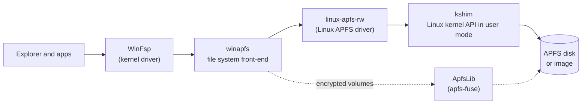

<p align="center">
  
</p>

<h1 align="center">winapfs</h1>

<p align="center">
  <b>Mac (APFS) disks on Windows, as ordinary drive letters.</b><br>
  Plug in a Mac-formatted drive and open it in Explorer: read it, and (experimentally) write to it.
</p>

<p align="center">
  <a href="https://github.com/christofilojohn/winapfs/releases"></a>
  <a href="LICENSE"></a>
  
  
</p>

---

APFS is the file system of every Mac since 2017, and of most external drives
formatted on a Mac. Windows can't read it. **winapfs** makes those volumes appear
in Explorer like any other drive: files, folders, Mac file names, compressed
files, symbolic links, extended attributes and timestamps all come through.

It is free software, built on the Linux APFS driver
([linux-apfs-rw](https://github.com/linux-apfs/linux-apfs-rw)) running in user
mode on Windows through [WinFsp](https://winfsp.dev). No kernel driver of its own,
no driver signing, nothing proprietary.

> [!WARNING]
> **Experimental software. Use it at your own risk.** winapfs is beta, and
> writing to APFS disks is experimental: a bug could corrupt a volume and lose
> data. **Back up anything you care about before connecting a disk, and before
> enabling writes.** Disks mount read-only by default; leave them that way if you
> only need to copy files off. winapfs comes with no warranty (see
> [No warranty](#no-warranty)).

## Features

- **Automatic mounting.** A background service mounts every APFS volume when a
  disk is connected, at a drive letter it remembers, and unmounts cleanly on
  "Safely Remove Hardware", unplugging and shutdown.
- **Tray app.** Every volume at a glance: open, mount, unmount, eject the disk,
  unlock encrypted volumes, switch a volume to read-write.
- **Faithful to the Mac side.**
  - Unicode file names exactly as stored, including characters Windows forbids
    (`: ? * | < > "`), which are mapped and round-trip
  - Case-sensitive and case-insensitive volumes
  - Compressed files (zlib, LZVN, LZFSE) decompressed on the fly
  - Extended attributes as NTFS-style alternate data streams
  - Symbolic links as Windows symlinks; FIFOs and devices as WSL reparse points
  - Creation, modification and access times
  - Dotfiles and Finder-hidden files shown as hidden, as on macOS
- **Encrypted volumes** (FileVault / encrypted APFS): read with the password or
  recovery key (tray "Unlock…", or `--ask`).
- **Read-write** (experimental) on images and, opt-in, on physical disks, with
  conservative safety checks (see [Writing](#writing-experimental)).
- **Several volumes per container**, GPT disks with 512- and 4096-byte sectors,
  and raw disk images (`.img`).

### Status

| | |
|---|---|
| Reading (files, metadata, xattrs, links, compression) | ✅ Stable, checked against manifests made on macOS |
| Encrypted volumes | ✅ Read-only |
| Writing to unencrypted volumes | 🧪 Experimental. Passes its own crash and consistency tests; the macOS `fsck_apfs` check of disks written by winapfs is still pending |
| Writing to encrypted volumes, snapshots | ⏳ Planned |
| Fusion drives, Time Machine and macOS system volumes (writing) | ⛔ Refused (read-only) |

## Install

1. Install **[WinFsp](https://winfsp.dev/rel/)** (2.x).
2. Download **`winapfs-<version>-x64.msi`** from
   [Releases](https://github.com/christofilojohn/winapfs/releases) and run it.
   The installer is not code-signed yet, so SmartScreen may ask you to confirm
   ("More info" → "Run anyway").

The installer adds the `winapfs` service (starts with Windows), the tray app,
and the command-line tools (on `PATH`). Connect an APFS disk and it appears as a
drive letter, **read-only** by default.

To uninstall, use *Settings → Apps*. Your disks are never touched.

## Use

### Explorer and the tray

APFS volumes show up under *This PC*. The **winapfs** icon in the notification
area lists every volume with its drive letter and state. Right-click a volume to:

- **Open** it in Explorer
- **Mount / Unmount**, or **Eject disk** (unmounts every volume on it, then ejects)
- **Unlock…** an encrypted volume (password or recovery key)
- **Read-write**: allow writing to this volume (see below)
- **Mount automatically**: on or off per volume

### Command line

```powershell
winapfs list                                   # APFS disks, partitions and volumes
winapfs mount disk.img *                       # an image at a free drive letter (no admin needed)
winapfs mount \\.\PhysicalDrive2 X: --volume "Macintosh HD - Data"   # admin
winapfs mount-all --ask                        # every volume; ask for passwords
winapfs ctl list                               # what the service has mounted
winapfs ctl eject Backup                       # unmount and eject a disk
winapfs-cli cat disk.img /path/in/volume       # read a file without mounting
winapfs-fsck \\.\PhysicalDrive2                # check a container (read-only)
```

`winapfs --help`, `winapfs service` and `winapfs ctl` describe every option.

## Writing (experimental)

Writing uses the same engine Linux uses, and every change goes through APFS's
copy-on-write transactions and checkpoints, so a crash or an unplugged cable
leaves the last checkpoint intact. Still, it is young code: **keep a backup.**

Writing is off by default. Turn it on per volume in the tray (*Read-write*), or
with `winapfs mount … --rw`. Physical disks also need *Allow writing to disks*
in the tray (`--allow-disk-writes` on the command line). winapfs refuses to
write when:

- the disk was **not ejected cleanly** from the Mac (crash, hibernation, cable
  pulled). Eject it properly on the Mac, or mount it read-only.
- the volume is **encrypted**, **sealed** (macOS system), a **Time Machine**
  backup, another **macOS-owned role**, or part of a **Fusion** drive.

Files the Mac stored compressed are rewritten uncompressed when you change them.

## How it works



- **Engine.** [linux-apfs-rw](https://github.com/linux-apfs/linux-apfs-rw), the
  read-write APFS driver for Linux, is compiled unchanged in spirit (a few
  marked patches) for Windows on top of **kshim**, a small user-mode
  implementation of the Linux kernel APIs it needs: page cache, buffer heads,
  inode cache, work queues, block devices.
- **Front-end.** winapfs implements a [WinFsp](https://winfsp.dev) file system:
  it maps Windows calls (CreateFile, ReadFile, rename, streams, reparse points,
  security) onto the engine.
- **Encrypted volumes** are read with ApfsLib from
  [apfs-fuse](https://github.com/sgan81/apfs-fuse), which also serves as an
  independent second reader in the tests.
- **Checking.** `winapfs-fsck` is [apfsprogs](https://github.com/linux-apfs/apfsprogs)'
  `apfsck`, ported to Windows.

### Testing

The test suite (150 tests, `ctest`) runs against disk images made on macOS by a
generator script (`testdata/generator`), with a manifest of every file's
contents and metadata:

- every volume is walked through the engine, through ApfsLib, and through a
  mounted drive letter with plain Win32 calls, and compared field by field;
- write tests replay hundreds of operations (renames, hard links, xattrs,
  compressed files, odd names) through the engine and through Explorer-style
  Win32 calls, then verify the result with both readers and `fsck`;
- **crash tests** cut the power at evenly spread points during a write storm
  (including a simulated volatile disk cache) and require a clean `fsck` and
  the last synced state, intact;
- regression tests for long copies, disk-full, memory bounds and the
  installer's service.

## Build from source

Requirements: Visual Studio 2022 Build Tools (C++ workload), CMake ≥ 3.20,
WinFsp with its developer files. The installer needs the WiX Toolset 5.

```powershell
build.cmd Release                                     # configure and build (x64)
ctest --test-dir build -C Release --output-on-failure # needs the test images
powershell -File installer\build.ps1                  # dist\winapfs-<version>-x64.msi
```

The test images (2.7 GB) are not in the repository. Make them on a Mac with
`testdata/generator` (see its README); `testdata/SHA256SUMS` lists the
expected checksums.

## Credits

winapfs stands on the work of these projects. Thank you.

| Project | Used for | Licence |
|---|---|---|
| [linux-apfs-rw](https://github.com/linux-apfs/linux-apfs-rw) by Ernesto A. Fernández and contributors | The APFS engine (read and write) | GPL-2.0-only |
| [apfsprogs](https://github.com/linux-apfs/apfsprogs) by Ernesto A. Fernández and contributors | `apfsck`, as `winapfs-fsck` | GPL-2.0 |
| [apfs-fuse](https://github.com/sgan81/apfs-fuse) by Simon Gander | ApfsLib: encrypted volumes, test oracle | GPL-2.0-or-later |
| [WinFsp](https://github.com/winfsp/winfsp) by Bill Zissimopoulos | User-mode file systems on Windows (installed separately) | GPL-3.0 with FLOSS exception |
| [LZFSE](https://github.com/lzfse/lzfse) by Apple Inc. | LZVN / LZFSE decompression | BSD-3-Clause |
| [zlib](https://zlib.net) by Jean-loup Gailly and Mark Adler | zlib-compressed files | zlib |
| [bzip2](https://sourceware.org/bzip2/) by Julian Seward | ApfsLib's DMG reader | bzip2 (BSD-style) |
| [nlohmann/json](https://github.com/nlohmann/json) by Niels Lohmann | Test manifests (tests only) | MIT |
| [WiX Toolset](https://wixtoolset.org) | Building the installer (build tool) | MS-RL |

The exact versions, local patches and full licence texts are listed in
[THIRD_PARTY_NOTICES.md](THIRD_PARTY_NOTICES.md). Apple's
[APFS Reference](https://developer.apple.com/support/downloads/Apple-File-System-Reference.pdf)
documents the on-disk format.

## No warranty

winapfs is experimental software provided **"as is", without warranty of any
kind**, express or implied, including fitness for a particular purpose. Writing
to APFS volumes is experimental and has not yet been validated by Apple's own
`fsck_apfs`; reading has been tested extensively, but no file system driver is
free of bugs. **You use winapfs at your own risk**: the authors and contributors
are not liable for any loss or corruption of data, or any other damage, arising
from its use (GPL-2.0, sections 11 and 12). Keep backups, eject disks properly
before unplugging them, and do not write to a disk you cannot afford to lose.

## Licence

winapfs is free software under the **GNU General Public License, version 2**
([LICENSE](LICENSE)). The program as a whole is GPL-2.0-only, because
linux-apfs-rw is; individual winapfs source files may say "GPL-2.0-or-later".
Bundled components keep their own licences (see above). The logo
([assets/logo.svg](assets/logo.svg)) is dedicated to the public domain (CC0 1.0).

winapfs uses WinFsp under its FLOSS exception:

> **WinFsp - Windows File System Proxy, Copyright (C) Bill Zissimopoulos**
> https://github.com/winfsp/winfsp

*APFS, Mac, macOS and FileVault are trademarks of Apple Inc. Windows is a
trademark of Microsoft Corporation. winapfs is an independent project, not
affiliated with or endorsed by either.*

*winapfs was developed with the help of Claude Opus 5.5, an AI model by
Anthropic, used for writing code, tests and documentation.*

## Contributing

Bug reports are very welcome, especially from real disks. Please include
`winapfs list` output, your Windows version, and for write problems the output
of `winapfs-fsck` on the disk. Never send disk images that contain private data.
